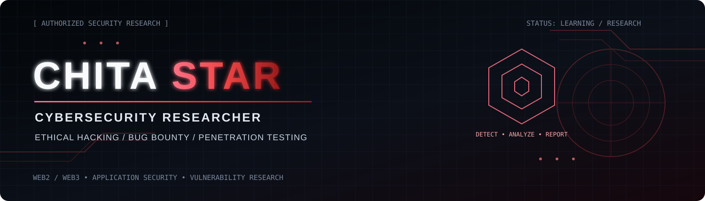

### `CYBERSECURITY RESEARCHER` · `ETHICAL HACKER` · `BUG BOUNTY HUNTER`

**Web2 & Web3 Security | Offensive Security | Vulnerability Research | Penetration Testing**

---

## `> whoami`

I'm a cybersecurity researcher focused on offensive security and application security. I study how web applications, APIs, authentication systems, and modern architectures fail—and how to report findings responsibly with clear evidence and practical remediation.

- 🔎 Researching web application and API security
- 🔐 Interested in authentication, authorization, sessions, and access-control weaknesses
- 🧪 Practicing structured security testing in authorized labs and in-scope programs
- 🛡️ Focused on responsible disclosure and actionable remediation
- 🌱 Continuously improving through hands-on labs and vulnerability research

## `> security-focus`

<table>
<tr>
<td width="50%" valign="top">

### 🌐 Web & API Security
- OWASP Top 10 testing
- Broken access control / IDOR / BOLA
- Authentication and session management
- API authorization and business logic
- Input validation and security misconfigurations

</td>
<td width="50%" valign="top">

### 🔑 Identity & Token Security
- JWT validation and claim handling
- Signature and algorithm configuration
- Expiration, issuer, and audience validation
- Role and privilege enforcement
- Session lifecycle and token revocation

</td>
</tr>
<tr>
<td width="50%" valign="top">

### ☁️ Infrastructure & Architecture
- Cloud security fundamentals
- Security configuration reviews
- Attack-surface mapping
- Secure design and threat modeling

</td>
<td width="50%" valign="top">

### 🧰 Research Workflow
- Scope and rules-of-engagement review
- Reproducible test cases
- Evidence collection and impact analysis
- Clear reports and remediation guidance

</td>
</tr>
</table>

## `> tools & technologies`

<!-- Keep only tools and languages you actually use; add/remove badges as your skills evolve. -->

  
  
  
  
  
  

## `> featured research & projects`

> Add links only to repositories you have actually published. These are suggested project slots—not claims that the projects already exist.

| Project | What to include |
|---|---|
| **Security Assessment Report** | Authorized lab scope, methodology, risk ratings, evidence, and remediation |
| **API Security Testing Notes** | Safe test cases for authentication, authorization, and input validation |
| **JWT Security Checklist** | Validation checks, common implementation flaws, and defensive recommendations |
| **Web Security Labs** | Write-ups from legal labs/CTFs, with sensitive secrets removed |

## `> github activity`

*Stats widgets are provided by third-party services and may be temporarily unavailable. They reflect public GitHub activity, not security skill or vulnerability counts.*

## `> responsible research`

I test only systems I own or have explicit permission to assess, follow program scope and rules, avoid accessing or changing other people's data, and report findings through the approved disclosure channel.

## `> connect`

- **GitHub:** [@CHITASTAR59](https://github.com/CHITASTAR59)
- **LinkedIn:** [@CHITASTAR59](https://www.linkedin.com/in/babu-ram-sharma-482527350/)
- **Discord:** [@CHITASTAR59](https://discord.com/users/1376608909766430730)

---

`ANALYZE • TEST RESPONSIBLY • DOCUMENT • DISCLOSE`

Built for a dark, red-accented cybersecurity profile. Customize it as your work evolves.

